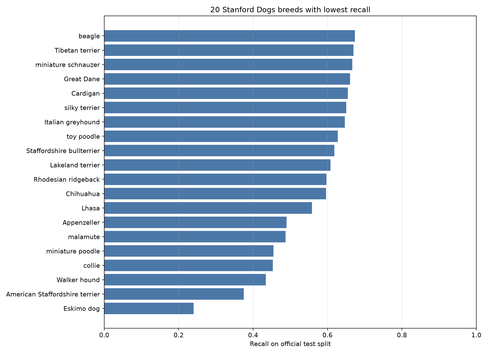
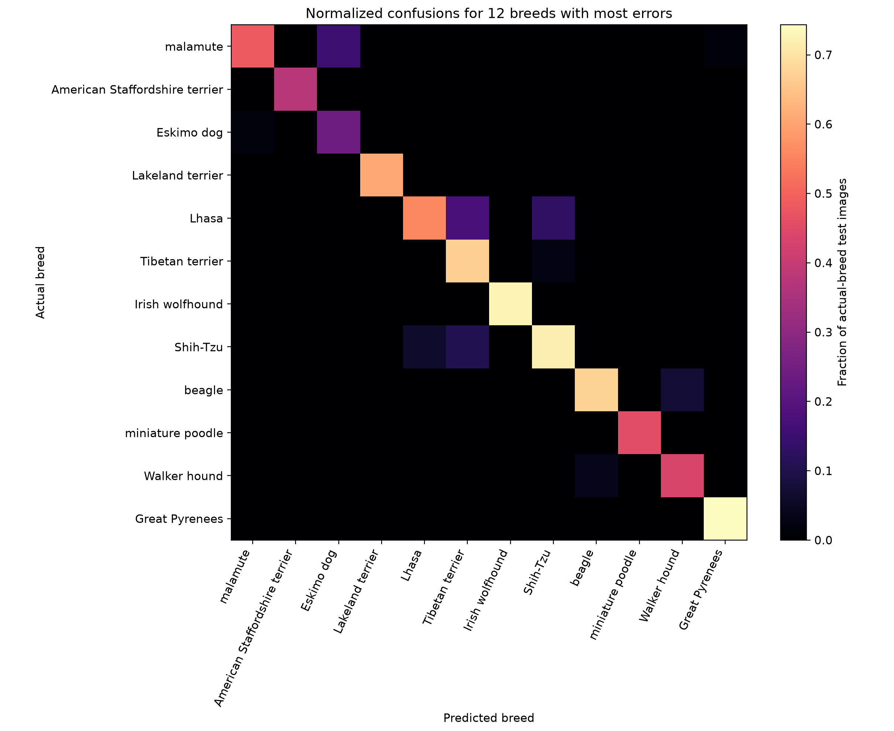

# Fine-Grained Dog Breed Classification on Stanford Dogs: A Reproducible Transfer-Learning Baseline and Error Analysis

**Author:** [Add author name and affiliation]

## Abstract

This study evaluates an ImageNet-pretrained EfficientNet-B0 for 120-class dog-breed classification on the Stanford Dogs dataset. The official training partition was divided into a fitting subset and a stratified validation subset, while the official test partition remained held out for final evaluation. The best validation checkpoint, selected after two fine-tuning epochs, reached 82.50% validation accuracy. On the 8,580-image official test partition, it achieved 82.26% top-1 accuracy, 82.11% macro precision, 81.84% macro recall, and 81.22% macro F1. This is a single-seed run and should be interpreted as a result for this split and training setup, not as a state-of-the-art claim.

**Keywords:** fine-grained visual classification, dog-breed recognition, transfer learning, EfficientNet-B0, Stanford Dogs, error analysis

## 1. Introduction

Fine-grained image classification distinguishes categories with small visual differences. Dog breeds are a clear example: two breeds may share coat color or body shape, while one breed can vary substantially in age, pose, grooming, and appearance. The Stanford Dogs dataset was introduced for this problem and contains 120 breeds, 20,580 images, class labels, and bounding-box annotations [1].

A classifier that predicts the correct breed across a full 120-class benchmark is a useful computer-vision baseline. However, one overall accuracy number can conceal severe differences among breeds. A model can perform well on many classes while confusing visually similar pairs or failing on a small subset. This project therefore evaluates both overall performance and per-breed errors.

The experiment uses an ImageNet-pretrained EfficientNet-B0, with its classifier replaced for the 120 dog breeds. The model is fine-tuned with RandAugment, label-smoothed cross-entropy, AdamW, and a cosine learning-rate schedule. The goal is to document a reproducible training procedure, report results on Stanford's official test split, and identify class confusions that can guide later experiments.

## 2. Literature Review

The Stanford Dogs benchmark was designed to expose the effects of low inter-class differences and high within-class variation, including pose, occlusion, and background clutter [1]. Early fine-grained work explored discriminative local patches and randomized decision trees [3]. Sermanet et al. applied recurrent visual attention directly to Stanford Dogs without bounding-box supervision. Their three-resolution, one-glimpse model reported 76.3% mean accuracy, compared with 75.5% for a GoogLeNet baseline [4]. These are mean-accuracy results and should not be treated as identical to top-1 accuracy without checking the evaluation definitions.

Bilinear CNNs capture local pairwise feature interactions by combining two convolutional feature streams [5]. Fully Convolutional Attention Networks (FCAN) learn discriminative image regions and report 87.3% for a fine-tuned ResNet-50 baseline, 88.5% with one attention region, and 88.9% with two on Stanford Dogs [7]. NTS-Net introduces a Navigator, Teacher, and Scrutinizer framework for locating informative regions on other fine-grained benchmarks; its reported experiments do not include Stanford Dogs [8].

Vision Transformers represent images as sequences of patches and can transfer effectively from large-scale pretraining [9]. Conde and Turgutlu use attention-guided cropping and erasing and report 93.2% accuracy on Stanford Dogs [10]. TransFG uses attention to select discriminative patches and a contrastive objective; it reports 92.3% on Stanford Dogs, compared with 91.7% for its standard ViT baseline [11]. Cui et al. study a separate pipeline that combines features from four CNNs, feature selection, and an SVM [12]. These results motivate fine-grained and attention-based extensions, but direct numerical comparison requires matching the split, image resolution, pretraining, and evaluation protocol.

## 3. Project Gap and Objective

The literature already includes attention-based and transformer-based methods with higher reported accuracy than this EfficientNet-B0 run. This project does not claim a new architecture or that the chosen analysis is absent from prior work. Its project-level contribution is a documented baseline using the official split, macro-averaged metrics, per-breed results, and an error analysis that can be reproduced from the supplied archive.

The experiment addresses two questions:

1. How well does an ImageNet-pretrained EfficientNet-B0 classify all 120 breeds under the official Stanford Dogs split?
2. Which breeds and breed pairs account for the largest share of its classification errors?

## 4. Methodology

### 4.1 Dataset and split

The local `archive.zip` contains 20,580 images and 20,580 annotation files. Stanford's official `train_list.mat` and `test_list.mat` were obtained separately from the dataset website. The official split contains 12,000 training images and 8,580 test images [1]. A stratified 10% subset of the official training partition (1,200 images) was used for validation, leaving 10,800 images for model fitting. The official test partition was not used for training or checkpoint selection.

### 4.2 Preprocessing and model

Images were processed at 224 × 224 pixels. Training augmentation used random resized crops (scale 0.65–1.0), horizontal flips, and RandAugment. Validation and test images were resized to 256 pixels and center-cropped to 224 pixels. All images were normalized with ImageNet channel means and standard deviations.

The classifier used ImageNet-pretrained EfficientNet-B0 weights with its final layer replaced by a 120-output layer. Training used 224-pixel images, batches of 32, random resized crops, horizontal flips, RandAugment, label-smoothed cross-entropy, and AdamW with separate learning rates for the feature extractor (1.5 × 10⁻⁴) and classifier (10⁻³), plus weight decay of 10⁻⁴. A cosine learning-rate schedule ran for two epochs with random seed 42 on Apple MPS. The checkpoint with the highest accuracy on the 1,200-image stratified validation subset was evaluated on the official test set.

### 4.3 Evaluation

The test evaluation reports top-1 accuracy, macro precision, macro recall, macro F1, a 120 × 120 confusion matrix, and per-breed precision, recall, F1, and support. Macro averaging gives each breed equal weight. The plotted confusion subset highlights the 12 breeds with the largest number of errors. The experiment is a single run; no confidence interval or multi-seed average is reported.

## 5. Results

The best validation accuracy was 82.50% at epoch two. The selected checkpoint achieved 82.26% top-1 test accuracy, 82.11% macro precision, 81.84% macro recall, and 81.22% macro F1 on the 8,580 official test images. The earlier ResNet-18 baseline measured 66.08% test accuracy; the new result is from a different architecture and training recipe, so this is not a controlled architecture-only comparison.

The lowest test recall was for Eskimo dog (24.0%), followed by American Staffordshire terrier (37.5%) and Walker hound (43.4%). Frequent directed confusions included Eskimo dog → Siberian husky (28 images), Great Pyrenees → kuvasz (24), malamute → Siberian husky (24), and silky terrier → Yorkshire terrier (19). The errors suggest that the model struggles with several visually related breed pairs, although a confusion count alone does not explain the visual cause.

Figure 1 shows the 20 breeds with lowest test recall. Figure 2 shows row-normalized confusions for the 12 breeds with the most errors.

## 6. Discussion

The overall test accuracy is substantially below results reported for larger fine-grained systems such as TransFG and the attention-guided ViT approach of Conde and Turgutlu [10], [11]. These are contextual reference points rather than direct head-to-head comparisons: this project uses EfficientNet-B0 at 224 pixels and reports one seed. The two-epoch run is brief, and a multi-seed study would be needed to assess variability and establish the stability of the result.

The per-breed results show why macro metrics and confusion analysis matter. Overall accuracy alone would hide the lower recall for Eskimo dog and American Staffordshire terrier. Several prominent errors involve breeds with similar appearance or related shape, but visual inspection is needed before attributing the errors to specific features. Bounding-box annotations could support a controlled follow-up study comparing full-image classification with dog-centered crops.

Important limitations are the single random seed, the single model family, and the absence of an ablation study. The project also does not measure inference latency or compare accuracy under a fixed compute budget. Consequently, it supports a baseline and error analysis, not a claim of state-of-the-art performance or broad generalization to photographs outside Stanford Dogs.

## 7. Conclusion

An ImageNet-pretrained EfficientNet-B0 was trained on the Stanford Dogs official training partition and evaluated on its untouched official test partition. It achieved 82.26% top-1 accuracy and 81.22% macro F1. The two-epoch run surpassed the project target of 80% on the held-out test set. Future work should run additional seeds and compare training duration, bounding-box crops, and fine-grained attention methods under the same split.

## References

[1] A. Khosla, N. Jayadevaprakash, B. Yao, and L. Fei-Fei, “Novel Dataset for Fine-Grained Image Categorization: Stanford Dogs,” in *First Workshop on Fine-Grained Visual Categorization, IEEE CVPR*, 2011. https://people.csail.mit.edu/khosla/papers/fgvc2011.pdf

[2] J. Deng, W. Dong, R. Socher, L.-J. Li, K. Li, and L. Fei-Fei, “ImageNet: A Large-Scale Hierarchical Image Database,” in *IEEE CVPR*, 2009. https://image-net.org/static_files/papers/imagenet_cvpr09.pdf

[3] B. Yao, A. Khosla, and L. Fei-Fei, “Combining Randomization and Discrimination for Fine-Grained Image Categorization,” in *IEEE CVPR*, 2011. https://svl.stanford.edu/assets/publications/pdfs/YaoKhoslaFeiFei_CVPR2011.pdf

[4] P. Sermanet, A. Frome, and E. Real, “Attention for Fine-Grained Categorization,” *ICLR Workshop*, 2015. https://arxiv.org/abs/1412.7054

[5] T.-Y. Lin, A. RoyChowdhury, and S. Maji, “Bilinear CNN Models for Fine-Grained Visual Recognition,” in *IEEE ICCV*, pp. 1449–1457, 2015. https://openaccess.thecvf.com/content_iccv_2015/html/Lin_Bilinear_CNN_Models_ICCV_2015_paper.html

[6] K. He, X. Zhang, S. Ren, and J. Sun, “Deep Residual Learning for Image Recognition,” in *IEEE CVPR*, pp. 770–778, 2016. https://openaccess.thecvf.com/content_cvpr_2016/html/He_Deep_Residual_Learning_CVPR_2016_paper.html

[7] X. Liu, T. Xia, J. Wang, Y. Yang, F. Zhou, and Y. Lin, “Fully Convolutional Attention Networks for Fine-Grained Recognition,” in *IEEE CVPR*, 2016. https://arxiv.org/abs/1603.06765

[8] Z. Yang, T. Luo, D. Wang, Z. Hu, J. Gao, and L. Wang, “Learning to Navigate for Fine-Grained Classification,” in *European Conference on Computer Vision (ECCV)*, pp. 420–435, 2018. https://openaccess.thecvf.com/content_ECCV_2018/html/Ze_Yang_Learning_to_Navigate_ECCV_2018_paper.html

[9] A. Dosovitskiy et al., “An Image Is Worth 16×16 Words: Transformers for Image Recognition at Scale,” in *International Conference on Learning Representations (ICLR)*, 2021. https://openreview.net/forum?id=YicbFdNTTy

[10] M. V. Conde and K. Turgutlu, “Exploring Vision Transformers for Fine-Grained Classification,” in *IEEE CVPR Workshops (FGVC8)*, 2021. https://arxiv.org/abs/2106.10587

[11] J. He, J.-N. Chen, S. Liu, A. Kortylewski, C. Yang, Y. Bai, and C. Wang, “TransFG: A Transformer Architecture for Fine-Grained Recognition,” in *Proceedings of the AAAI Conference on Artificial Intelligence*, vol. 36, no. 1, pp. 852–860, 2022. https://ojs.aaai.org/index.php/AAAI/article/view/19967

[12] Y. Cui, B. Tang, G. Wu, L. Li, X. Zhang, Z. Du, and W. Zhao, “Classification of Dog Breeds Using Convolutional Neural Network Models and Support Vector Machine,” *Bioengineering*, vol. 11, no. 11, 1157, 2024. https://doi.org/10.3390/bioengineering11111157
